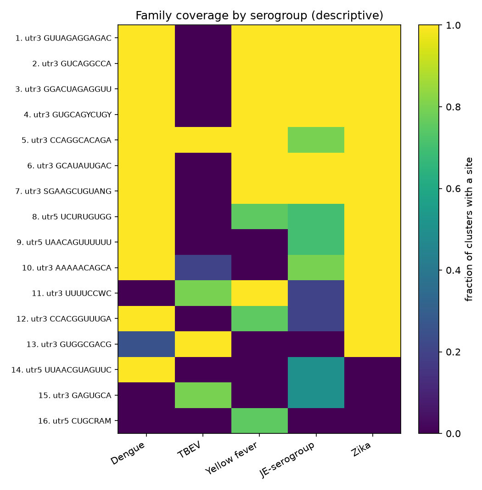
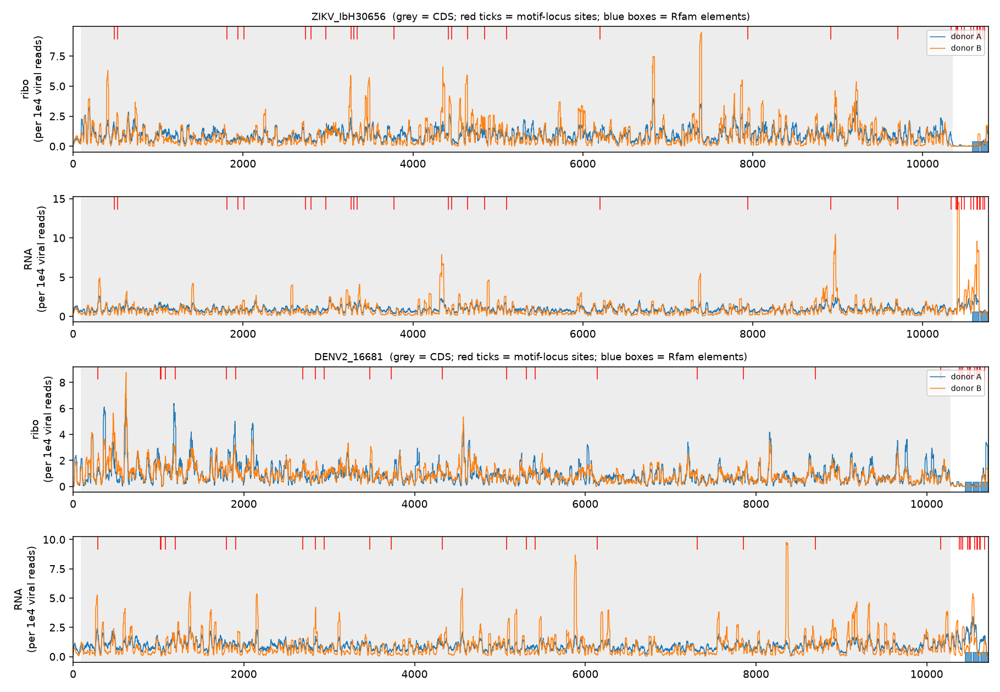

# rna_motif — candidate regulatory motifs in viral RNA (Orthoflavivirus test project)

A small, laptop-scale pipeline (Apple M2 Pro, no GPU; every step runs in minutes) that collects public viral RNA
genomes, discovers **candidate** sequence motifs, tests whether they hold up on genomes the discovery never saw,
ranks them, and checks them against known RNA elements and ribosome-profiling data.

**One-paragraph summary.** From 238 flavivirus genomes (dengue, Zika, West Nile, JEV, yellow fever, tick-borne
encephalitis and relatives) I kept 207 after quality control. They are extremely redundant (207 genomes ≈ 25 distinct
90%-identity clusters), so every statistic counts clusters, not sequences, and every validation holds out whole
serogroups. Of 246 motifs found by STREME, **41 replicate in a held-out serogroup** (FDR < 0.05), nearly all in the 3'UTR;
they merge into **16 families**, and the 3'UTR ones into **10 loci**. The strongest loci lie on known Rfam elements
(Flavivirus_DB, Flavi_CRE) and are conserved in all mosquito-borne groups but not in the tick-borne virus. Ribosome
profiling of ZIKV/DENV-2-infected cells shows the 3'UTR is essentially not translated, so these motifs are
**conservation signals in non-translated RNA — not evidence of an effect on translation efficiency (TE)**. A statistical
motif→TE link was not possible with public data (see Phase 3).

---

## 1. What a "candidate motif" is here (and what it is not)

| | Candidate motif (this project) | Validated functional element |
|---|---|---|
| Evidence | Over-represented, and found again in held-out virus groups | Experiment: mutagenesis + reporter/replication assay, structure probing (SHAPE), covariation across species |
| What it shows | A recurring sequence pattern, i.e. conservation | That the element *does* something (e.g. stalls the exonuclease, enhances replication) |
| Can arise without function | Yes: shared ancestry, protein-coding constraint, base composition | No (by construction) |

Only motifs overlapping Rfam-curated elements (which are themselves computationally predicted, with experimental
support in the literature) get an annotation, and even then it is a *plausibility* check, not validation.

## 2. Status of each phase

| Phase | Content | State |
|---|---|---|
| 0 | Setup, standards, plan | done |
| 1 | Data download, QC, redundancy clustering, group split | done |
| 2 | Motif discovery, held-out validation, Rfam positive control, families and loci, ranking | done |
| 3 | Link motifs to TE | done **descriptively only** (a statistical link is impossible with public data) |
| 4 | This report | done |

## 3. Phase 1 — data and quality control (task 1)

- **Source:** NCBI GenBank (nuccore) via Biopython/Entrez, genus *Orthoflavivirus*, complete genomes of 9–12.5 kb, ≤ 20 per
  species (12 species), downloaded 2026-10-31 (query, date, checksums: `docs/MANIFEST_orthoflavi_v1.tsv`).
  Metadata parsed from the GenBank record: organism, taxon id, host, country, date, molecule type, CDS coordinates.
- **QC (all counts in `docs/qc_report_orthoflavi_v1.md`, per-record reasons in `docs/qc_log_orthoflavi_v1.tsv`):**
  238 → **207** records. Removed: 13 with >1% non-ACGU bases, 16 length outliers (robust z-score), 1 without UTR flanks,
  1 exact duplicate. Kept but flagged: 12 without CDS annotation, 10 stored as cDNA ("DNA" type, normal for RNA viruses), and
  records with missing host/date (country is missing everywhere, so it is never used). T→U conversion applied.
- **Regions:** 5'UTR / CDS / 3'UTR cut from the longest annotated CDS (the polyprotein). Median UTRs ≈ 95 nt (5') and ≈ 450 nt (3').
- **How repeated sampling of related viruses is handled (the bias the task asks about).** Outbreak sequencing gives
  thousands of near-identical genomes per species. (a) At most 20 genomes per species enter. (b) MMseqs2 clusters the genomes
  at 80 / 90 / 95% identity into 14 / 25 / 47 clusters (a 4:1 to 15:1 redundancy). (c) Motif support is counted
  in **clusters, never in sequences**. (d) Train/test splits are made by **serogroup**, because related species (dengue 1–4,
  the JE group) are still ~65–75% identical and would otherwise leak between train and test.

## 4. Phase 2 — motif discovery and ranking (task 2)

**Pipeline** (rationale for every choice: `docs/DECISIONS.md`, entries C-01 … C-25):

1. **Leave-one-serogroup-out discovery.** Five serogroups (Dengue, Zika, JE-serogroup, Yellow fever, TBEV). For each,
   STREME discovers motifs in the other four and the held-out one is used only for testing; 5 folds × {5'UTR, 3'UTR}.
2. **Test on the held-out group.** FIMO scans the held-out cluster representatives; the statistic is the number of clusters
   with a site, compared with 200 dinucleotide-preserving shuffles (empirical p), Benjamini–Hochberg across all 246 tests.
   "Replicated" = FDR < 0.05 **and** hits in ≥ 2 held-out clusters.
3. **Families.** Tomtom (all-vs-all, q < 0.05 in both directions) merges the 41 replicated motifs into 16 families.
4. **Loci.** Families whose sites fall in the same Rfam element are merged into one locus (12 3'UTR families → 10 loci).
5. **Ranking.** Not one opaque score. Sorted by (1) number of held-out serogroups where a member replicated, then
   (2) serogroups with a site, (3) clusters with a site, (4) discovery E-value; all columns are in the table.

**Results**

| Check | Result |
|---|---|
| Motifs found / tested on held-out groups | 246 |
| Replicated (FDR < 0.05, ≥ 2 clusters) | **41** (35 in 3'UTR, 6 in 5'UTR) |
| Discovery strength predicts replication | 14/45 (31%) of motifs with discovery E < 0.05 replicate vs 27/201 (13%) of the rest |
| Families / 3'UTR loci | 16 / 10 (3 defined by Rfam elements) |
| Replicated sites overlapping a known Rfam element | 54% (chance: 41% of 3'UTR nucleotides lie in an Rfam hit) — modest, descriptive |
| Rfam-covered nucleotides lying under a replicated motif | 19% (low recall) |

Top 3'UTR loci (full table: `results/families_v1/loci_ranked.tsv`; coverage figure below):

| Rank | Locus | Motifs | Held-out groups replicated (of 5) | Clusters with a site (of 25) |
|---|---|---|---|---|
| 1 | Flavivirus_DB (3 families, e.g. `GUUAGAGGAGAC`) | 13 | 4 | 20 |
| 2 | unannotated `GUCAGGCCA` (early 3'UTR, where an xrRNA would sit; **unconfirmed**) | 6 | 4 | 20 |
| 3 | unannotated `GUGCAGYCUGY` | 5 | 4 | 20 |
| 4 | Flavi_CRE (`CCAGGCACAGA`, end of the 3'UTR; present in all 5 groups) | 3 | 3 | 23 |
| 5 | unannotated `GCAUAUUGAC` | 3 | 3 | 20 |



The top families occur in every mosquito-borne group and **not** in TBEV (tick-borne), mirroring the known split
between these virus lineages. The 5'UTR families are weak and partly low-complexity (e.g. `UAACAGUUUUUU`).

**Sanity checks that were run**
- A motif planted in synthetic RNA is recovered; random RNA yields 0 motifs at E < 0.05 (`tests/test_planted_motif.py`).
  This also exposed that STREME's default reporting threshold is not multiple-testing safe, so I filter on its E-value (C-09b).
- Rfam covariance models behave as expected: the tick-borne models hit only TBEV; Flavi_CRE hits all groups.

## 5. Phase 3 — relation to translation efficiency (TE)

**Why no statistical motif→TE model.** Viral genomes are one polyprotein ORF, so infection Ribo-seq yields about one
TE-like value per virus. I found two usable public datasets (survey and sources: `docs/TE_DATA_SURVEY.md`). Using
GSE207347 (ZIKV and DENV-2 in human neural progenitor cells; 2 donors per condition) that is n = 2 viruses × 2 donors, and virus
identity would be a perfect surrogate for the label (leakage standard LK-5/6). I found no viral-UTR MPRA dataset.

**What I did instead (descriptive).** Streamed the 12 Ribo-seq/RNA-seq libraries (6 GB), trimmed (cutadapt), mapped to the two viral
genomes (bowtie2), and computed ribosome/RNA density per region.

- Quality: 73–77% of footprint P-sites fall in one reading frame (genuine Ribo-seq); uninfected and cross-virus samples contain ≤ ~200 viral reads versus 26,000–930,000 in the matching infected samples.
- **3'UTR ribosome/RNA density is only 6–22% of the coding region's**; DENV-2's 5'UTR is high (1.3–1.8×), consistent with the authors' report.
- The top motif loci all lie in the non-translated 3'UTR (only ~350 footprints per virus in the whole 3'UTR), so per-site
  counts are 0–30 and uninterpretable. Any TE effect would be indirect (e.g. via the sfRNA or replication), not a direct translation signal.



## 6. Limitations (read these before trusting anything above)

1. **Conservation ≠ function.** "Replicated" means conserved across serogroups. Shared ancestry, protein-coding constraint
   and base composition can produce this without regulatory function.
2. **One virus genus, 207 genomes, ~25 clusters.** Conclusions do not extend to other viruses. Power is low (Zika has only
   2 held-out clusters; the held-out empirical p-values bottom out at 0.005, so many top hits tie at FDR 0.030).
3. **Serogroup split reduces but cannot eliminate ancestry leakage.**
4. **Rfam hits are predictions**; the xrRNA model misses dengue xrRNAs, so "unannotated" does not mean "unknown element".
   The 50% overlap rule for merging loci, the 1e-4 FIMO cutoff, the 200 shuffles and the QC thresholds are my choices.
5. **Coverage numbers in the family table are descriptive** (they include the discovery sequences).
6. **Coding region (CDS) not analysed**: it needs a codon-preserving background (codon usage confounds k-mers).
7. **Phase 3 is descriptive**: no TE inference. ZIKV reference is ~9 nt shorter at the 5' end than the authors' (affects 5'UTR density).
8. **Mistakes caught during the work** (all logged in `docs/RESULTS_LOG.md`): a wrong join key made the first validation report 0 replicated motifs
   (found because every count, including the null, was exactly 0); QC first dropped valid cDNA-typed genomes; a family-count miscount
   (13/3 → correct 12/4) and a late-binding bug in the density script were fixed. There is no automated regression test for the join bug yet.

## 7. Decisions I made on your behalf (please confirm or change)

| ID | Assumption | Where |
|---|---|---|
| D1 | Genus *Orthoflavivirus* from GenBank | C-01 |
| D2 | 90% identity clustering (80/95% as checks), MMseqs2 | C-06 |
| D3 | 3-mer/dinucleotide-preserving shuffle as background (STREME default control + `fasta-shuffle-letters`) | C-09b, C-10 |
| D4 | TE data: descriptive use of GSE207347 only | C-23, C-25 |
| D5 | Regions cut by annotation; 5'UTR and 3'UTR only | C-15 |
| D6 | Methodological references: the two papers below; `reference/golden_standard/SUMMARY.md` is **still a draft awaiting your approval** | — |

Golden standards used: Bernett et al., *Nature Methods* 2024 (data-leakage questions; local PDF) and Jin et al., *J Biol Chem* 2025
(mRNA design review; summarised from the open-access web text, not a PDF). Neither covers motif-enrichment statistics or Ribo-seq
processing, so those choices follow tool defaults and common practice (stated in `docs/DECISIONS.md`).

## 8. Tools (one-line refreshers) and why they were chosen

| Tool | What it is | Why |
|---|---|---|
| MMseqs2 | Fast sequence clustering | Standard for redundancy reduction; installable on CPU |
| STREME (MEME Suite) | Finds motifs enriched in a set versus shuffled controls, with Fisher-exact statistics | Published, directly gives enrichment against a background |
| FIMO / Tomtom (MEME Suite) | Scan sequences for a motif / compare motifs and merge similar ones | Reference implementations |
| Infernal + Rfam | Covariance-model search for known RNA families | Curated source of known flavivirus elements; avoids typing sequences from memory |
| cutadapt, bowtie2, samtools, SRA toolkit | Trimming, short-read alignment, BAM handling, SRA streaming | Standard Ribo-seq/RNA-seq building blocks |
| statsmodels | Benjamini–Hochberg FDR | Standard implementation |

## 9. Reproduce

```bash
conda env create -f environment.yml -n rnamotif          # MEME Suite, MMseqs2, ViennaRNA, Infernal, Python stack
conda env create -f environment_riboseq.yml -n riboseq   # only for Phase 3
python scripts/01_fetch.py   --outdir data/raw/orthoflavi_v1 --per-species 20
python scripts/02_qc.py      --raw data/raw/orthoflavi_v1 --out data/processed/orthoflavi_v1
python scripts/03_cluster.py --fasta data/processed/orthoflavi_v1/viral_clean.fasta --out data/processed/orthoflavi_v1/clusters
python scripts/04_split.py   --dir data/processed/orthoflavi_v1
python scripts/05_regions.py --dir data/processed/orthoflavi_v1
python scripts/06_logo.py    --dir data/processed/orthoflavi_v1 --out results/logo_v2
python scripts/07_known_elements.py --dir data/processed/orthoflavi_v1 --logo results/logo_v2
python scripts/08_families.py --dir data/processed/orthoflavi_v1 --logo results/logo_v2 --out results/families_v1
python scripts/09_loci.py    --fam results/families_v1 --logo results/logo_v2
pytest tests                                              # planted-motif / null sanity tests
# Phase 3: scripts/10c_run_parallel.sh (≈6 GB streamed download), then scripts/11_te_descriptive.py
```
Note: scripts call tools by absolute path in `/opt/anaconda3/envs/...`; edit the `BIN` constants if your conda lives elsewhere.
Data are not stored in git (regenerated by the commands above). Random seeds: split 42, STREME 1, shuffles 1.
Runtime on the M2 Pro: Phases 1–2 about 5 minutes in total; Phase 3 about 35 minutes plus download.

## 10. Where to look

`docs/DECISIONS.md` — every method choice with rationale and alternatives · `docs/RESULTS_LOG.md` — chronological results incl. failures ·
`docs/TE_DATA_SURVEY.md` — TE data search · `docs/qc_report_orthoflavi_v1.md` — QC · `PLAN.md` — original plan and revision log ·
`results/` — tables and figures · `scripts/` — numbered pipeline · `reference/` — standards and Rfam models · `.claude/logs/` — automatic work log (from your hook).
