# rna_motif — finding and ranking candidate regulatory motifs in viral RNA

A small, laptop-scale pipeline (Apple M2 Pro, CPU only; every step runs in minutes) that downloads public viral RNA
genomes, cleans them, discovers **candidate** sequence motifs, tests them on virus groups the discovery never saw,
ranks them with statistics against a background, and compares them with known RNA elements and ribosome-profiling data.

> **Result in one paragraph.** 238 flavivirus genomes were downloaded and 207 kept after quality control. They are extremely
> redundant (207 genomes ≈ 25 distinct clusters at 90% identity), so every statistic counts *clusters*, and every validation holds
> out whole virus serogroups. STREME reported 246 motifs; **41 replicate in a held-out serogroup** (FDR < 0.05), nearly all in the 3'UTR.
> They merge into **16 families**, and the 3'UTR ones into **10 loci**. The strongest loci lie on known Rfam elements
> (Flavivirus_DB, Flavi_CRE) and are conserved in all mosquito-borne groups but not in the tick-borne virus. Ribosome profiling shows the 3'UTR is
> essentially not translated, so these are **conservation signals in non-translated RNA — not evidence of an effect on translation
> efficiency (TE)**. A statistical motif→TE model was not possible with public data.

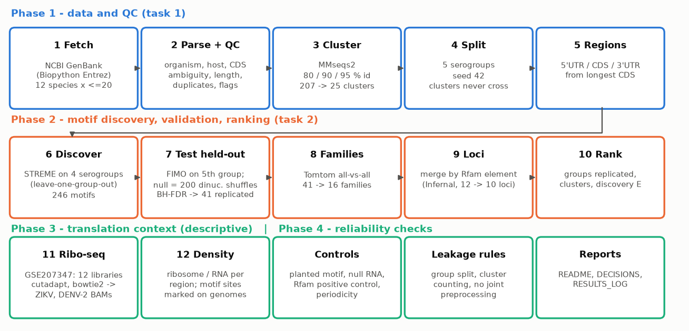

---

## How this README answers the brief

| Requirement in the brief (Chinese original) | Answered in |
|---|---|
| 任务1 解析序列及其元数据 — parse sequences and metadata | [Q1.1](#q11-how-are-sequences-and-metadata-parsed) |
| 识别序列类型、来源和已有注释 — sequence type, source, existing annotation | [Q1.2](#q12-how-are-sequence-type-source-and-existing-annotation-identified) |
| 处理重复序列、非标准碱基、长度异常和缺失数据 — duplicates, non-standard bases, abnormal length, missing data | [Q1.3](#q13-how-are-duplicates-non-standard-bases-abnormal-lengths-and-missing-data-handled) |
| 记录序列来源、分类信息、数据库版本 — record source, taxonomy, database version | [Q1.4](#q14-what-is-recorded-about-source-taxonomy-and-database-version) |
| 避免同源病毒重复采样产生统计偏差 — avoid bias from repeated sampling of homologous viruses | [Q1.5](#q15-how-is-statistical-bias-from-repeatedly-sampled-related-viruses-avoided) |
| 任务2 找到候选局部序列模式 — find candidate patterns (what method, why) | [Q2.1](#q21-which-method-finds-the-candidate-motifs-and-why-this-one) |
| 统计出现频率和覆盖范围 — frequency and coverage | [Q2.2](#q22-how-are-frequency-and-coverage-measured) |
| 与合理背景比较 — comparison with a reasonable background | [Q2.3](#q23-what-background-are-motifs-compared-with) |
| 输出排名和统计证据 — ranking and statistical evidence | [Q2.4](#q24-what-is-the-ranking-and-what-evidence-supports-it) |
| 候选 motif 与已验证功能元件的区别 — candidate vs validated functional element | [Q2.6](#q26-how-does-a-candidate-motif-differ-from-a-validated-functional-element) |
| 说明如何评价候选结果的可靠性 — how to judge reliability | [Section 4](#4-how-reliable-are-the-results) |
| How many motifs were found? | [Q2.5](#q25-how-many-motifs-were-found) |
| One real record traced through every step | [Section 6](#6-worked-example-one-genome-traced-through-the-whole-pipeline) |

---

# 1. Task 1 — data acquisition and quality control

## Q1.1 How are sequences and metadata parsed?

`scripts/01_fetch.py` downloads GenBank flat files (NCBI nuccore, via Biopython `Bio.Entrez`); `scripts/02_qc.py` parses them with
Biopython `SeqIO`. One GenBank record yields one row of metadata plus the sequence:

| Field | Taken from | Used for |
|---|---|---|
| accession.version, definition | LOCUS / DEFINITION | identity, traceability |
| organism, taxon id | `source` feature (`organism`, `db_xref taxon:`) | species grouping |
| host, country, collection date | `source` qualifiers | metadata QC (often missing) |
| molecule type | LOCUS line | sequence-type check (Q1.2) |
| length, non-ACGT count | sequence | QC filters |
| CDS coordinates (longest CDS = polyprotein) | `CDS` features | cut 5'UTR / CDS / 3'UTR |

The parsed record of a real genome is shown step by step in the [worked example](#6-worked-example-one-genome-traced-through-the-whole-pipeline).

## Q1.2 How are sequence type, source and existing annotation identified?

- **Sequence type:** the GenBank molecule type. Flavivirus genomes are single-stranded (+)RNA; 10 records are stored as cDNA
  (`DNA` type, normal for RNA viruses) and are kept and flagged, with T→U conversion applied to all.
- **Source:** all records come from one database (NCBI GenBank); organism, taxon id and host come from the record's `source` feature.
- **Existing annotation:** only structural annotation exists in GenBank (CDS, mature peptides, sometimes UTR features). It is used to cut the genome into
  5'UTR / CDS / 3'UTR. GenBank has **no functional labels for motifs**, which is the premise of the task; known RNA elements are added later from Rfam (Q2.6).
  12 records have no CDS annotation; they are kept but excluded from UTR analyses.

## Q1.3 How are duplicates, non-standard bases, abnormal lengths and missing data handled?

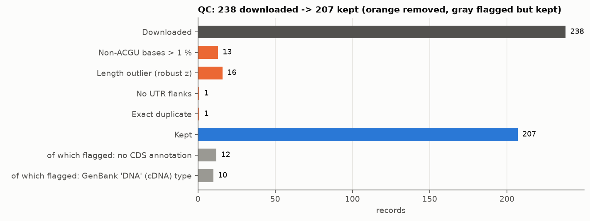

| Problem | Rule (and why) | Records affected |
|---|---|---|
| Non-standard bases (N, IUPAC codes) | drop if > 1% of the sequence (unreliable genome); ≤ 1% left in place (negligible effect) | 13 dropped |
| Abnormal length | robust z-score (median/MAD within species, scale floored at 50 nt) > 3.5: removes truncated or concatenated genomes. MAD, not SD, so the outliers do not hide themselves; the floor was added after the first run wrongly dropped valid genomes when lengths were almost identical | 16 dropped |
| UTR flanks missing | CDS leaving < 10 nt on either side makes UTR analysis impossible | 1 dropped |
| Exact duplicates | SHA-256 of the sequence; first accession kept. *Near*-duplicates are not dropped but handled by clustering (Q1.5) | 1 dropped |
| Missing metadata | host, date, country, no-CDS records are **flagged, not dropped**; `country` is missing everywhere so it is never used as a variable | flagged |
| cDNA-typed records | kept (they are RNA-virus genomes); the first version of the script wrongly dropped them, see Limitations | 10 flagged |

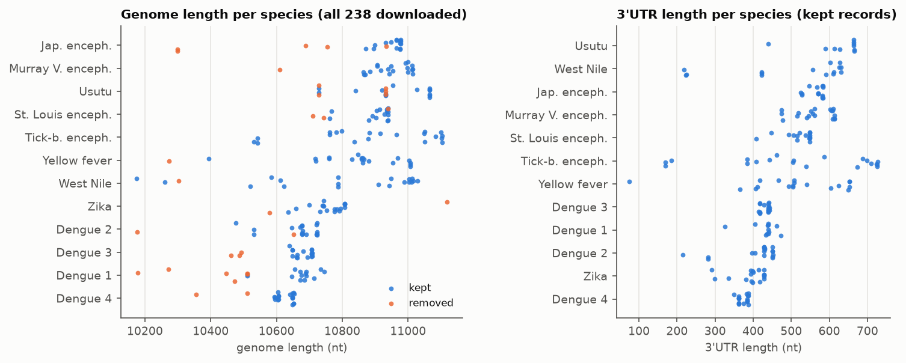

Every removal is logged with its reason (`docs/qc_log_orthoflavi_v1.tsv`; summary `docs/qc_report_orthoflavi_v1.md`). Net: **238 → 207 records**.

## Q1.4 What is recorded about source, taxonomy and database version?

`docs/MANIFEST_orthoflavi_v1.tsv` stores, for each species: the exact Entrez query, number of hits and records fetched, file name and SHA-256,
the download date (2026-10-31) and the GenBank release number (**274.0**). Caveat: the release number was read from NCBI one day *after* the
download (it was not captured at download time; `01_fetch.py` now records it automatically). Taxonomy (organism, taxon id) is in
`data/processed/orthoflavi_v1/metadata_clean.tsv`. Software versions are in `environment.yml` and `docs/qc_report_orthoflavi_v1.md`.

## Q1.5 How is statistical bias from repeatedly sampled related viruses avoided?

Outbreak sequencing deposits thousands of near-identical genomes of the same virus (e.g. 2,835 dengue-1 genomes in GenBank). Counting each
copy would make a "recurrent" motif simply a copied sequence. Four safeguards, each backed by the data-leakage guidelines (Bernett et al. 2024, questions 1, 3, 4):

1. **Cap per species:** at most 20 genomes per species enter (12 species), so outbreak-heavy species cannot dominate.
2. **Cluster by identity (MMseqs2):** 207 genomes collapse to 14 / 25 / 47 clusters at 80 / 90 / 95 % identity.
3. **Count clusters, never sequences:** a motif's support is the number of clusters (and serogroups) in which it occurs.
4. **Split by serogroup:** related species (dengue 1–4, the JE group) are still 65–75% identical, so whole serogroups are held out; no cluster ever spans train and test.

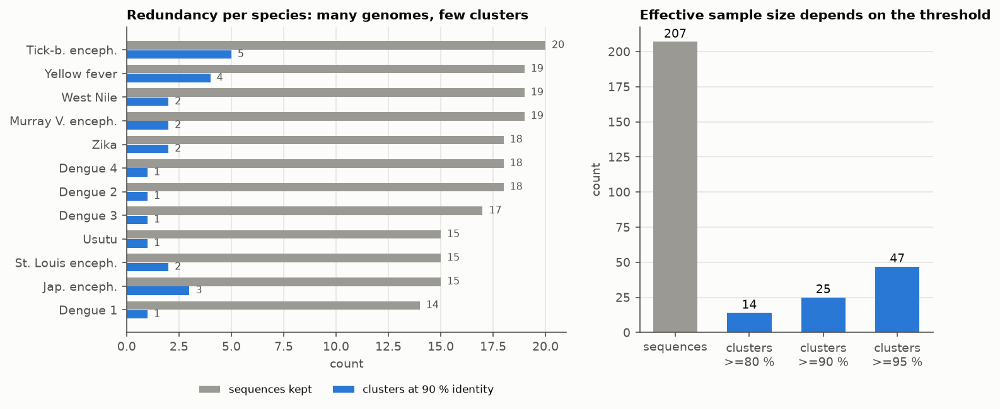

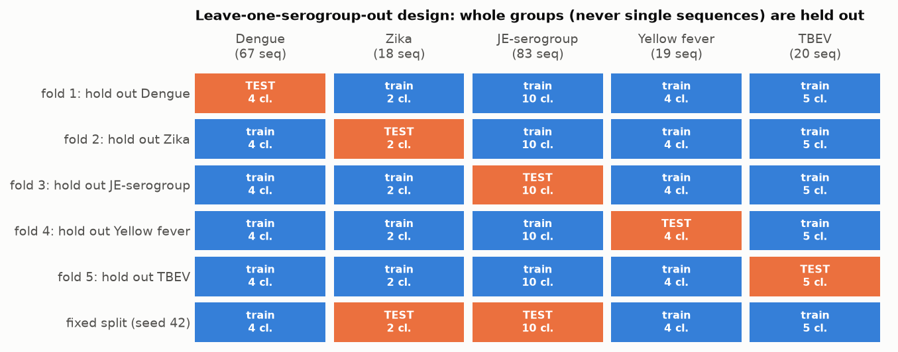

---

# 2. Task 2 — motif discovery

## Q2.1 Which method finds the candidate motifs, and why this one?

**Method: STREME** (MEME Suite; "finds motifs that are more frequent in your sequences than in shuffled control copies, and reports a position
weight matrix plus a significance"). Run as **leave-one-serogroup-out**: discover on four serogroups, test on the fifth, rotate through all five,
separately for 5'UTR and 3'UTR.

Why this choice (full reasoning for every choice: `docs/DECISIONS.md`, C-01 … C-25):
- It directly provides what the brief asks for: candidate patterns (PWMs), frequency, comparison with a control background and a significance, from a published, widely used tool, instead of my own k-mer code.
- It is discriminative (enrichment versus a control), not just "frequent", which guards against motifs that are common only because of base composition.
- Leave-one-group-out uses ~80% of the data in each discovery run, which the small data set needs (a fixed 3-group training set found nothing).

Rejected alternatives: home-built k-mer counting + PWM merging (reinvents a tool), DREME (older, short motifs only), HOMER. Neural models were not considered: 207 genomes cannot support them.

## Q2.2 How are frequency and coverage measured?

For every motif, FIMO (MEME Suite) scans sequences for sites at p < 10⁻⁴. Frequency and coverage are reported at three levels:

| Measure | Definition | Why this level |
|---|---|---|
| Sites per sequence | number of FIMO hits | positional detail (see map below) |
| **Cluster coverage** | share of 90%-clusters with ≥ 1 site (e.g. 20 of 25) | removes redundancy; the unit used for all tests |
| **Serogroup coverage** | number of held-out serogroups in which it replicates (of 5) | breadth of conservation; the first ranking criterion |
| Position | location along the 3'UTR, against Rfam elements | functional context |

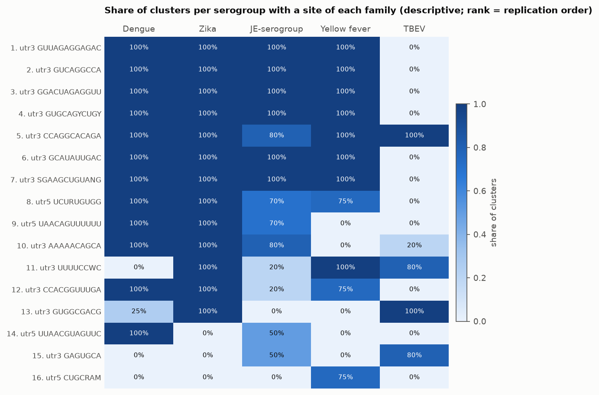

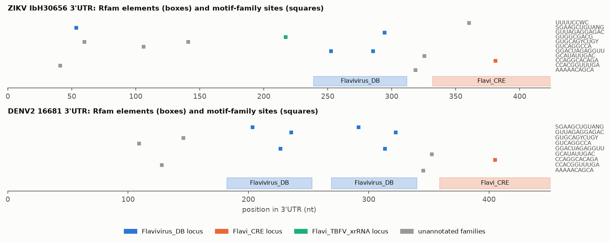

(Coverage percentages include the discovery sequences, so they are descriptive; the replication test uses held-out data only.)

## Q2.3 What background are motifs compared with?

Three separate backgrounds, each doing a different job:

1. **During discovery:** STREME's own control = each input sequence shuffled while preserving its 3-mer frequencies (stricter than a dinucleotide shuffle).
2. **During testing (the main test):** the held-out group's sequences are shuffled 200× preserving dinucleotide counts (`fasta-shuffle-letters -kmer 2`; preservation verified); the number of clusters with a site is compared with the real count. Empirical p = (1 + shuffles ≥ observed) / 201.
3. **Calibration on synthetic RNA:** a motif planted in 70% of random sequences must be recovered, and random RNA must give nothing.

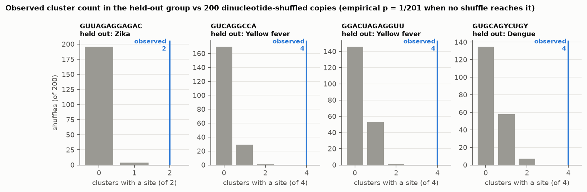

The calibration also showed STREME's default report is not multiple-testing safe: on random RNA it lists 3 motifs at E ≈ 2–3. I therefore keep only E < 0.05 for discovery claims and decide replication on held-out data.

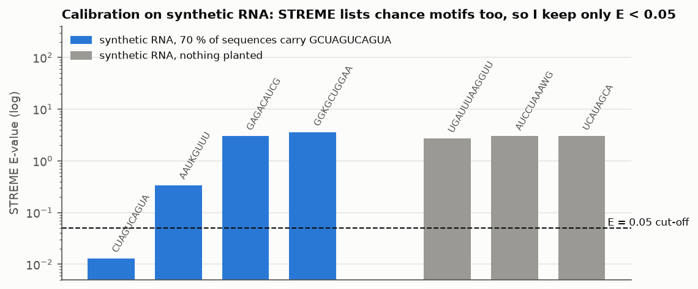

## Q2.4 What is the ranking, and what evidence supports it?

Not one opaque score. Families and loci are sorted by (1) number of held-out serogroups in which a member replicated, then (2) serogroups with a site,
(3) clusters with a site, (4) best discovery E-value; every column is in the output table. Replication test: FIMO count in the held-out group vs the shuffle null,
Benjamini–Hochberg FDR over all 246 tests; "replicated" = FDR < 0.05 **and** sites in ≥ 2 held-out clusters.

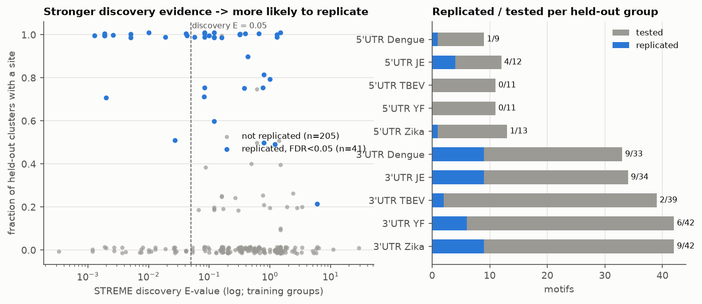

Top 3'UTR loci (full table `results/families_v1/loci_ranked.tsv`; families `families_ranked.tsv`):

| Rank | Locus | Motifs | Groups replicated (of 5) | Clusters with a site (of 25) | Best discovery E |
|---|---|---|---|---|---|
| 1 | Flavivirus_DB (3 families, e.g. `GUUAGAGGAGAC`) | 13 | 4 | 20 | 0.0013 |
| 2 | unannotated `GUCAGGCCA` (early 3'UTR; **not confirmed** as an xrRNA) | 6 | 4 | 20 | 0.0019 |
| 3 | unannotated `GUGCAGYCUGY` | 5 | 4 | 20 | 0.043 |
| 4 | Flavi_CRE (`CCAGGCACAGA`) | 3 | 3 | 23 | 0.010 |
| 5 | unannotated `GCAUAUUGAC` | 3 | 3 | 20 | 0.0019 |

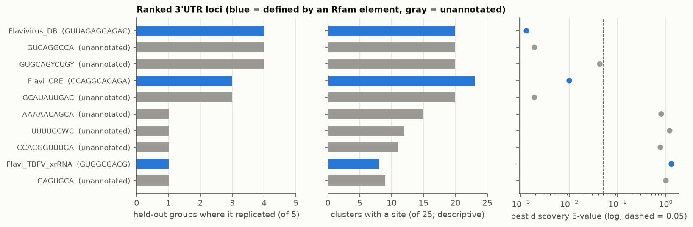

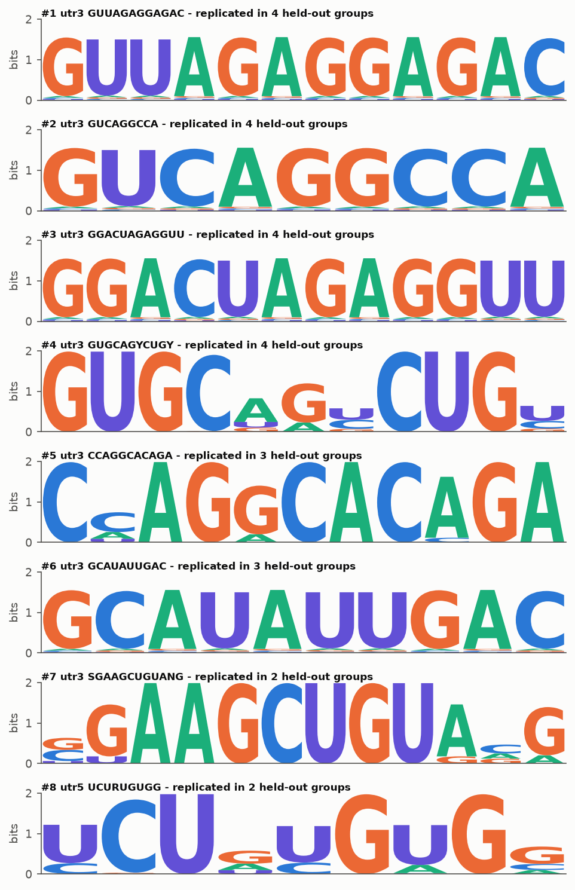

## Q2.5 How many motifs were found?

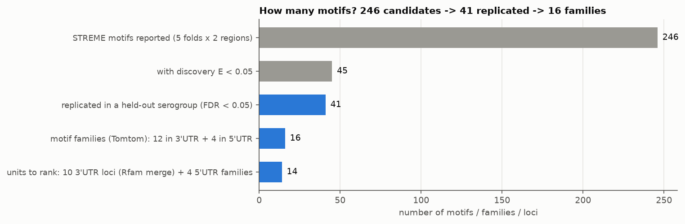

**246** candidate motifs were reported by STREME across the 10 discovery runs; **45** of them had discovery E < 0.05; **41 replicated** on held-out serogroups
(35 in the 3'UTR, 6 in the 5'UTR). The 41 are not independent: they merge (Tomtom, "compares PWMs and merges similar ones") into **16 families**
(12 in 3'UTR, 4 in 5'UTR), and the 12 3'UTR families into **10 loci** by Rfam element (only Flavivirus_DB merged three families). Stronger discovery evidence predicts replication: 31% of
motifs with discovery E < 0.05 replicated vs 13% of the rest.

## Q2.6 How does a candidate motif differ from a validated functional element?

| | Candidate motif (this project) | Validated functional element |
|---|---|---|
| Evidence | over-represented and found again in held-out virus groups | experiment: mutagenesis + reporter/replication assay, structure probing (SHAPE), covariation across species |
| Shows | a recurring sequence pattern, i.e. conservation | that the element *does* something |
| Can arise without function | yes: shared ancestry, protein-coding constraint, base composition | no, by construction |
| In this project | all 41 replicated motifs | none (no wet-lab evidence was generated or used) |

As a plausibility check the candidates were compared with Rfam covariance models of known flavivirus elements (Infernal): 54% of replicated 3'UTR motif sites fall
inside a known element, against 41% expected by chance (a modest enrichment), and only 19% of Rfam-covered nucleotides lie under a replicated motif. The Rfam models behave
correctly (tick-borne models hit only TBEV), but Rfam hits are themselves predictions, and the xrRNA model misses dengue.

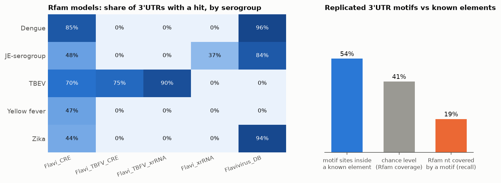

---

# 3. Link to translation efficiency (TE) — descriptive only

Infection Ribo-seq yields about one TE-like value per virus (a genome is one polyprotein ORF). The best public data set, GSE207347 (ZIKV and DENV-2 in human neural
progenitor cells), gives n = 2 donors per virus, and virus identity would be a perfect surrogate for the label; no viral-UTR reporter library was found
(`docs/TE_DATA_SURVEY.md`). So no motif→TE model was fitted. Instead the 12 libraries (6 GB, streamed) were trimmed (cutadapt), mapped to the two viral genomes (bowtie2) and the
ribosome/RNA density was computed per region.

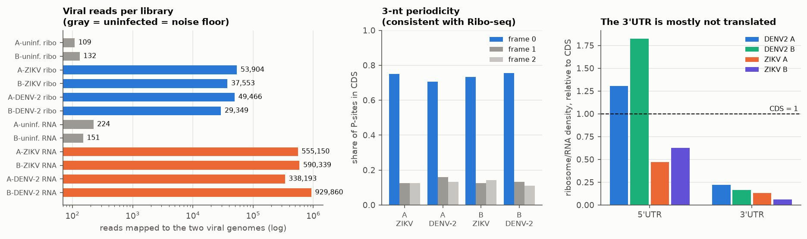

- The libraries look like genuine Ribo-seq (73–77% of footprints in one reading frame; ≤ ~200 background reads in uninfected samples).
- The 3'UTR carries only 6–22% of the coding region's ribosome/RNA density (its RNA signal also includes the accumulating sfRNA fragment), so the top motif loci sit in a region that is mostly **not translated**.
  Any TE effect would be indirect (e.g. sfRNA or replication). With ~350 footprints in the whole 3'UTR per virus, per-site counts are 0–30 and uninterpretable.


---

# 4. How reliable are the results?

| Check | Result | Status |
|---|---|---|
| Planted motif is recovered | yes (E ≈ 0.01) | done |
| Random RNA gives no discoveries | 0 at E < 0.05 (STREME default list does contain chance motifs, see Q2.3) | done |
| Replication on data not used for discovery | 41 / 246 replicate; discovery strength predicts replication | done |
| Multiple testing | BH-FDR across all 246 tests, plus ≥ 2 clusters required | done |
| Redundancy controlled | counts are per cluster; split by serogroup | done |
| Positive control (known elements) | Rfam models behave; 54% vs 41% overlap, 19% recall | done (modest) |
| Sanity of translation data | periodicity, noise floor | done |
| Sensitivity to the identity threshold (80% / 95%) | clusters computed, **pipeline only run at 90%** | **not done** |
| Sensitivity to the background (codon-preserving, Markov) | **not done**; CDS not analysed | **not done** |
| More shuffles (p-values bottom out at 0.005, many ties at FDR 0.030) | **not done** | **not done** |
| Automated regression test for the FIMO join bug | **not done** | **not done** |
| Experimental validation | none | out of scope |

# 5. Limitations

1. **Conservation ≠ function.** "Replicated" means conserved across serogroups; shared ancestry, coding constraint and composition can produce it.
2. **One virus genus, 207 genomes, ~25 clusters.** Zika has only 2 held-out clusters. Conclusions do not extend to other viruses.
3. **The serogroup split reduces but cannot eliminate ancestry leakage.**
4. **Rfam hits are predictions**; "unannotated" does not mean "unknown element". The 50% overlap rule, FIMO p < 10⁻⁴, 200 shuffles and QC thresholds are my choices.
5. **Coverage numbers are descriptive** (they include discovery sequences). The coding region was not analysed (needs a codon-preserving background).
6. **Phase 3 is descriptive**; the ZIKV reference is ~9 nt shorter at the 5' end than the authors' (affects 5'UTR density).
7. **Mistakes caught during the work** (logged in `docs/RESULTS_LOG.md`): a wrong join key made the first validation report 0 replicated motifs (noticed because every count, including the null, was exactly 0);
   QC first dropped valid cDNA-typed genomes; a family count (13/3 → correct 12/4) and a late-binding bug in the density script were fixed; the GenBank release number was not recorded at download time.
8. **Decisions I made for you, please confirm:** virus genus (D1), 90% identity (D2), shuffle background (D3), TE data use (D4), regions by annotation (D5). `reference/golden_standard/SUMMARY.md` is **still a draft awaiting your approval**.
   The Jin et al. summary is based on web text covering ~43% of the paper. Neither standard covers motif statistics or Ribo-seq processing.

---

# 6. Worked example: one genome traced through the whole pipeline

Real output of `scripts/13_example_trace.py MN566104.1` (a Zika virus genome from a human, Haiti 2016, which is its cluster's representative):

```
== 1 PARSE (GenBank record -> fields)
LOCUS MN566104 10808 bp ss-RNA | Zika virus isolate Haiti/0011/2016, complete genome
{'organism': 'Zika virus', 'host': 'Homo sapiens', 'collection_date': '31-May-2016', 'isolate': 'Haiti/0011/2016'} | taxon: ['taxon:64320']
longest CDS (polyprotein): 108..10379  -> 5'UTR 107 nt, 3'UTR 429 nt
non-ACGT bases: 0 | T->U applied for RNA

== 2 QC checks
length 10808 nt vs species median 10764: robust z = 0.87 (limit 3.5) -> pass | ambiguity 0 % (limit 1 %) -> pass | unique sequence hash -> pass | has CDS and UTR flanks >= 10 nt -> pass
entries for this accession in qc_log: none (kept, no flags)

== 3 CLUSTER (MMseqs2, >=90 % identity)
cluster representative MN566104.1, cluster size 13 -> this record's weight = 1/13 = 0.077; members: KU926309.2, KX694532.2, KY328289.1, KY765325.1, MF794971.1, MH157202.1 ...

== 4 SPLIT
serogroup = Zika; fixed split (seed 42): heldout; in leave-one-group-out fold 'hold out Zika' this record is TEST data, in the 4 other folds it is TRAINING data

== 5 REGIONS
5'UTR 107 nt | CDS 10272 nt | 3'UTR 429 nt

== 6 MOTIF SITES FOUND IN THIS 3'UTR (family representatives, FIMO p<1e-4)
family #12 CCACGGUUUGA    3'UTR nt 36-46  matched CCACAGCUUGG  p=4.3e-06
family #7 SGAAGCUGUANG   3'UTR nt 48-59  matched GAAAGCUGUGCA  p=5.1e-05
family #4 GUGCAGYCUGY    3'UTR nt 55-65  matched GUGCAGCCUGU  p=4.8e-07
family #2 GUCAGGCCA      3'UTR nt 102-110  matched GUCAGGCCG  p=5.3e-05
family #4 GUGCAGYCUGY    3'UTR nt 136-146  matched AUGCUGCCUGU  p=7.5e-05
family #13 GUGGCGACG      3'UTR nt 213-221  matched GUGGCGACC  p=7.6e-05
family #3 GGACUAGAGGUU   3'UTR nt 280-291  matched GGACUAGUGGUU  p=2.2e-06
family #1 GUUAGAGGAGAC   3'UTR nt 289-300  matched GUUAGAGGAGAC  p=6.0e-08
family #10 AAAAACAGCA     3'UTR nt 314-323  matched CAAAACAGCA  p=1.9e-06
family #6 GCAUAUUGAC     3'UTR nt 321-330  matched GCAUAUUGAC  p=9.5e-07
family #11 UUUUCCWC       3'UTR nt 357-364  matched GUUUCCAC  p=4.6e-05
family #5 CCAGGCACAGA    3'UTR nt 376-386  matched CCAGGCACAGA  p=2.4e-07

== 7 EVIDENCE FOR THE #1 FAMILY (held out: Zika)
discovered on the other 4 groups with STREME E=0.0013; in held-out Zika: 2/2 clusters have a site vs 0.02 expected in dinucleotide shuffles; empirical p=0.0050, BH FDR=0.030, replicated=True
```

Reading it: the genome passes every QC rule (step 2); it stands for 13 near-identical genomes (step 3, weight 1/13); because Zika is held out in fold 2, motifs discovered **without** Zika are tested on it (step 7).
Its 3'UTR carries sites of 11 of the 12 3'UTR families; the strongest hits (`GUUAGAGGAGAC` at nt 289–300, `CCAGGCACAGA` at nt 376–386) lie inside the Rfam elements that Infernal finds in this very record
(Flavivirus_DB at 3'UTR nt 239–312, E = 2e-16; Flavi_CRE at nt 332–428, E = 2e-12). Remember the p-value floor: with only 2 held-out Zika clusters the smallest possible p is 0.005.

---

# 7. Tools (one-line refreshers)

| Tool | What it is | Why |
|---|---|---|
| Biopython | Sequence and GenBank parsing, NCBI Entrez access | standard parser |
| MMseqs2 | Fast sequence clustering | standard redundancy reduction |
| STREME (MEME Suite) | Finds motifs enriched versus shuffled controls, with Fisher-exact statistics | published enrichment-based motif finder |
| FIMO / Tomtom (MEME Suite) | Scan sequences for a motif / compare and merge similar motifs | reference implementations |
| Infernal + Rfam | Covariance-model search for known RNA families | curated known flavivirus elements |
| cutadapt, bowtie2, samtools, SRA toolkit | Trimming, short-read alignment, BAM handling, SRA streaming | standard Ribo-seq building blocks |
| statsmodels | Benjamini–Hochberg FDR | standard implementation |

Golden standards: Bernett et al., *Nature Methods* 2024 (data leakage; local PDF) and Jin et al., *J Biol Chem* 2025 (mRNA design review; summarised from web text).

# 8. Reproduce

```bash
conda env create -f environment.yml -n rnamotif          # MEME Suite, MMseqs2, ViennaRNA, Infernal, Python stack
conda env create -f environment_riboseq.yml -n riboseq   # only for Phase 3
python scripts/01_fetch.py   --outdir data/raw/orthoflavi_v1 --per-species 20
python scripts/02_qc.py      --raw data/raw/orthoflavi_v1 --out data/processed/orthoflavi_v1
python scripts/03_cluster.py --fasta data/processed/orthoflavi_v1/viral_clean.fasta --out data/processed/orthoflavi_v1/clusters
python scripts/04_split.py   --dir data/processed/orthoflavi_v1
python scripts/05_regions.py --dir data/processed/orthoflavi_v1
python scripts/06_logo.py    --dir data/processed/orthoflavi_v1 --out results/logo_v2
python scripts/07_known_elements.py --dir data/processed/orthoflavi_v1 --logo results/logo_v2
python scripts/08_families.py --dir data/processed/orthoflavi_v1 --logo results/logo_v2 --out results/families_v1
python scripts/09_loci.py    --fam results/families_v1 --logo results/logo_v2
pytest tests                                              # planted-motif / null sanity tests
# Phase 3: scripts/10c_run_parallel.sh (≈6 GB streamed download), then scripts/11_te_descriptive.py
python scripts/12_figures.py                              # all figures in docs/figures/
python scripts/13_example_trace.py MN566104.1             # the worked example
```
Scripts call tools by absolute path under `/opt/anaconda3/envs/...`; edit the `BIN` constants if your conda lives elsewhere. Data are not stored in git (regenerated by the commands above).
Seeds: split 42, STREME 1, shuffles 1. Runtime on an M2 Pro: phases 1–2 about 5 minutes; phase 3 about 35 minutes plus download.
Figure colours: validated default palette (blue/orange/aqua + gray) from the dataviz skill; sequential single-hue heatmaps.

# 9. Where to look

`docs/DECISIONS.md` every method choice with rationale · `docs/RESULTS_LOG.md` chronological results including failures · `docs/TE_DATA_SURVEY.md` TE data search ·
`docs/qc_report_orthoflavi_v1.md` QC · `PLAN.md` original plan · `results/` tables and figures · `scripts/` numbered pipeline · `reference/` standards and Rfam models ·
`.claude/logs/` automatic work log (from your hook).
